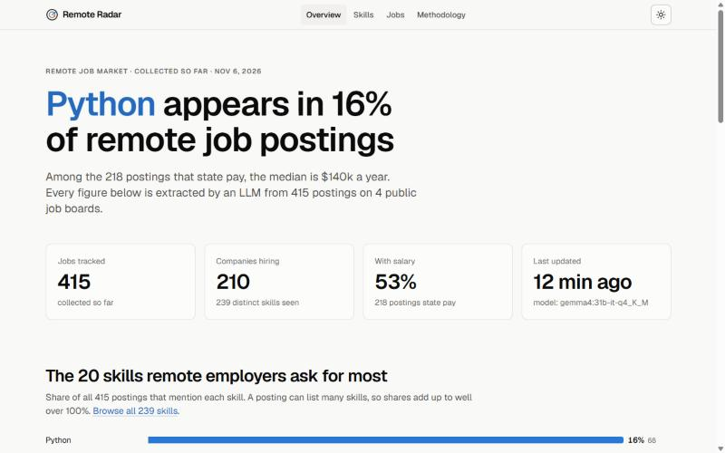

# Remote Radar

**What do remote employers actually ask for? A nightly pipeline reads remote job postings from nine public sources (job boards, company career pages and Hacker News), extracts skills, seniority and salary with an LLM, and publishes the results as a public dashboard. A CV matcher runs entirely in your browser.**

[](https://github.com/intenza2k-netizen/remote-radar/actions/workflows/ci.yml)


[](LICENSE)

**Live demo:** https://remote-radar-nine.vercel.app



## Why I built this

I am moving into data analyst and data engineering roles without a traditional computer science background. When I read job ads I could not tell which requirements were common and which were one company's wish list, and I did not want to guess. So I built something that counts.

It also gave me a reason to build the whole chain once, end to end: collecting data from public APIs, cleaning it, using an LLM for the part that is genuinely unstructured, checking how accurate that LLM is, and publishing the result somewhere a person can look at it. It is a learning project, and the Methodology page on the site says plainly what the numbers can and cannot tell you.

## What it does

- **Collects** remote job postings every night from nine public sources and keeps the raw responses so later steps can be re-run. The sources are five job-board APIs, the public job-board APIs of 44 curated companies (Greenhouse, Ashby and Lever), and the monthly Hacker News "Who is hiring" thread.
- **Cleans and deduplicates** them: normalises titles and companies, turns HTML into text, parses free-text salaries and collapses cross-posted duplicates.
- **Extracts structure with an LLM**: role, seniority, skills, employment type and salary, validated against a schema. The same prompt runs on the Claude API or on a local model through Ollama.
- **Measures the models**: both backends are scored against a hand-labelled set of postings, so the choice of model rests on accuracy, latency and cost rather than a hunch.
- **Embeds the jobs** (`radar embed`) with a small open embedding model, so the CV matcher can compare a CV with each posting.
- **Publishes a static snapshot** (JSON files) that a Next.js dashboard renders:
  - **Overview**: most requested skills, weekly trends, role mix, advertised salary by seniority, sources.
  - **Skills**: searchable table with share of postings, four-week change and median salary.
  - **Skill detail**: weekly trend, skills it is requested with, recent matching jobs.
  - **Jobs**: filter postings by skill, seniority, role, region and salary; every result links to the original listing.
  - **Match my CV** (`/match`): paste or upload a CV and get a ranked list of jobs with a score breakdown and the skills you are missing. Everything runs in your browser (transformers.js in a Web Worker), so the CV is never uploaded. The score mixes semantic similarity (0.4), skill overlap (0.35), seniority fit (0.15) and role fit (0.1), with a prior that stops jobs listing very few skills from floating to the top. The matcher also uses the other analyses, again entirely in the browser: an "I can work from" location (remembered locally) that keeps only postings open to you, the job types of your 30 best data matches, an estimated pay range for your profile with the model's held-out error beside it, and a "next skill to learn" list that re-scores only the skills part with each missing skill added and shows the pay association next to the postings it opens up.
  - **Insights** (`/insights`): skill pay premium with confidence intervals from a bootstrap that resamples companies, so one employer with many postings cannot drive a result, shown both as a raw gap and adjusted for role, seniority and region (a regression of log salary on the skill plus role, seniority and coarse region-group dummies, with a switch between the two views), seniority lift with Newcombe intervals, a skill co-occurrence graph and the top skills per role.
  - **Pay estimator** (in Insights): pick a role, seniority, region group and skills and get an estimated yearly pay range from a ridge regression of log advertised salary, with its measured error beside the number. Accuracy comes from 5-fold cross-validation grouped by company (no company in both train and test, the regularisation strength chosen again inside each training part) and is compared with a plain role-and-seniority median; if the model did not beat that baseline, the page would say so. It estimates advertised pay, not what anyone earns, and skill effects are associations.
  - **Companies** (`/companies`): the companies that are hiring, with their postings.
  - **Locations** (`/locations`): "remote" often means remote within one country, so pick where you live and see how many postings, and how many data roles, are actually open to applicants there (worldwide, your country, or a region that contains it such as the EU or EMEA), what they pay and which skills the open data jobs ask for. The same filter ("Open to applicants in") is on the Jobs page. Postings that name no region are left out rather than guessed at.
  - **Job types** (`/job-types`): the open data-role postings grouped into archetypes (data analyst, BI analyst, analytics engineer, data engineer, data scientist, ML engineer, data annotation, ...) by clustering their embeddings with seeded spherical k-means. k is picked by silhouette with a stated tie-break, names come from a keyword list over titles plus a distinguishing skill (no LLM at publish time), and every type shows its size, signature skills with lift, seniority mix, median advertised pay (only with 5 or more salaries), common titles and three typical postings. Clusters that are fuzzy or have mixed titles are labelled as such, and the page says that the 2-D map keeps only a small part of the variance.
  - **Methodology**: how it works, extraction accuracy, how much of the data is targeted at data roles, and known limitations.

Lists on the site (jobs, matcher, companies) show only active listings, meaning jobs the source still listed at its latest successful fetch. The statistics use every posting in the 8-week window, active or not.

## Architecture

```mermaid
flowchart LR
    A["9 sources<br/>job boards, company ATS boards,<br/>Hacker News"] --> B[("raw_jobs")]
    B --> C["ingest<br/>normalise + dedupe"]
    C --> D[("jobs")]
    D --> E{"extract"}
    E -- Claude API --> F["schema validation<br/>one retry"]
    E -- local Ollama --> F
    F --> G[("extractions<br/>job_skills")]
    G --> M["embed<br/>job vectors, cached"]
    M --> H["aggregate + publish"]
    H --> I["web/public/data/*.json"]
    I --> J["git push"]
    J --> K["Vercel"]
    K --> L["Next.js dashboard"]
    L --> N["Match my CV<br/>runs in the browser"]
```



The full diagram, the SQLite schema, design decisions and known limitations are in [docs/architecture.md](docs/architecture.md).

## Tech stack

| Layer | Tools |
|---|---|
| Pipeline | Python 3.12, [uv](https://docs.astral.sh/uv/), httpx, pydantic, SQLAlchemy, SQLite, Typer, Rich, selectolax, tenacity |
| LLM backends | Anthropic Python SDK (Claude), Ollama (local model on an RTX 5090) |
| Embeddings | `bge-small-en-v1.5`: ONNX Runtime and tokenizers in the pipeline, transformers.js in the browser |
| Dashboard | Next.js 16 (App Router), React 19, TypeScript, Tailwind CSS 4, hand-written SVG charts |
| Quality | pytest, Ruff, ESLint, GitHub Actions |
| Operations | PowerShell and Windows Task Scheduler for the nightly run, Vercel for hosting |

## Model comparison

<!-- EVAL:START -->
The same prompt and schema were run on 40 labelled postings with four models: one hosted, three local on an RTX 5090.

| Model | Skills F1 [95% CI] | Seniority | Role | Salary | Median latency | Cost / 1k jobs |
|---|---|---|---|---|---|---|
| Claude Sonnet 5.5 (API) | 0.770 [0.70–0.82] | 0.850 | 0.900 | 0.900 | 2.3 s | $5.46 |
| gemma4 31B (local) | **0.832** [0.76–0.89] | 0.800 | 0.925 | 0.875 | 1.3 s | $0 |
| Qwen 3.8 27B (local) | 0.730 [0.64–0.79] | 0.825 | **0.950** | 0.850 | 1.5 s | $0 |
| gemma4 12B (local) | 0.670 [0.58–0.74] | 0.775 | 0.900 | 0.875 | 0.8 s | $0 |

- **What the data supports:** gemma4 12B is measurably worse at skills than the larger models. Claude and gemma4 31B are statistically indistinguishable on every field at this sample size (paired bootstrap).
- **Decision:** the nightly run uses gemma4 31B. It matches the hosted model within the noise, at zero marginal cost.
- **Caveat:** the 40 gold labels are drafts written by a Claude model before any extractor ran, and are awaiting human review, so they may favour Claude slightly. With 40 jobs, differences of a few points are noise. Claude has the highest skills recall (0.97) and gemma4 31B the highest precision (0.78), so the F1 ranking depends partly on how exhaustively the gold lists were written.

Full report with confidence intervals, paired comparisons, a seniority confusion matrix and error analysis: [`pipeline/eval/report.md`](pipeline/eval/report.md). Method and limitations: [`pipeline/eval/README.md`](pipeline/eval/README.md).
<!-- EVAL:END -->

## Data sources

Job data comes from public APIs. Every posting on the dashboard links back to the page that published it, and the published snapshot contains no job descriptions, only derived fields and the link.

The sources are listed in dedupe order. When the same job appears on more than one source, the copy already in the database stays canonical, and within one batch the earliest posting wins. See [docs/architecture.md](docs/architecture.md#dedupe-order-and-source-scope).

| # | Source | Scope | Notes |
|---|---|---|---|
| 1 | [Remotive](https://remotive.com) | broad | Remote jobs API. The free API returns few jobs per request. |
| 2 | [Remote OK](https://remoteok.com) | targeted | Remote OK's terms require crediting them and keeping links to them followed; both are done here. Also reads the data, data-science and analyst tag feeds. |
| 3 | [Arbeitnow](https://www.arbeitnow.com) | broad | Free job board API. |
| 4 | [Jobicy](https://jobicy.com) | targeted | Remote jobs API. Also reads the data-science industry feed. |
| 5 | [Himalayas](https://himalayas.app) | targeted | Found by keyword searches aimed at data roles. Apply links are used unchanged, as the API terms ask. |
| 6 | Greenhouse boards | broad | Public job-board API of a curated list of companies. Remote postings only. |
| 7 | Ashby boards | broad | Same curated list, Ashby API. Remote postings only. |
| 8 | Lever boards | broad | Same curated list, Lever API. Remote postings only. |
| 9 | [Hacker News "Who is hiring"](https://news.ycombinator.com) | broad | The monthly thread, read through the Algolia API. Keeps top-level comments whose first line says remote. |

The Greenhouse, Ashby and Lever sources read 44 companies listed in [`pipeline/src/radar/sources/ats_companies.yaml`](pipeline/src/radar/sources/ats_companies.yaml). The list was picked by hand, so it is not a sample of all employers.

**Targeted sources over-represent data roles.** A source marked "targeted" is searched or filtered toward data roles (keywords, tags or an industry feed). Data roles are therefore deliberately over-represented, and the Methodology page on the site states the targeted share. In the snapshot of 6 November 2026 the targeted sources supply about 47% of the postings in the window, and data roles make up 35% of postings. Compare skills with each other, not with the whole remote job market.

## Run it yourself

### Prerequisites

- [uv](https://docs.astral.sh/uv/) (installs Python 3.12 for you)
- Node.js 24 and npm
- [Ollama](https://ollama.com) with a model pulled, for example `ollama pull gemma4:12b`
- Optional: an `ANTHROPIC_API_KEY` to use the Claude backend

### Run the pipeline

```bash
cd pipeline
uv sync
uv run radar --help
```

Try a small run first (fetches everything, extracts only 20 jobs with a local model):

```bash
uv run radar run-all --backend ollama --model gemma4:12b --limit 20
```

`run-all` is `fetch -> ingest -> extract -> embed -> publish`, and it writes the snapshot to `web/public/data/`. The same stages are available one at a time:

```bash
uv run radar fetch                     # pull postings into raw_jobs
uv run radar ingest                    # normalise and mark duplicates
uv run radar extract --backend ollama  # LLM extraction (use --limit N to cap it)
uv run radar embed                     # job vectors for the CV matcher (cached; --force re-embeds)
uv run radar aggregate                 # print the summary, write nothing
uv run radar publish                   # write the snapshot JSON files
uv run radar stats                     # row counts per stage
```

To use Claude instead, set the key and pick the backend:

```bash
export ANTHROPIC_API_KEY=...           # PowerShell: $env:ANTHROPIC_API_KEY = "..."
uv run radar run-all --backend claude
```

The first `radar embed` downloads the embedding model files (a pinned revision of `Xenova/bge-small-en-v1.5`, checked against a SHA-256) from Hugging Face. Later runs embed only new or changed jobs.

The SQLite database is created at `data/jobs.sqlite` (git-ignored). Defaults can be changed with environment variables:

| Variable | Default | Meaning |
|---|---|---|
| `RADAR_BACKEND` | `ollama` | Extraction backend: `claude` or `ollama` |
| `RADAR_OLLAMA_MODEL` | `gemma4:31b-it-q4_K_M` | Local model tag |
| `RADAR_CLAUDE_MODEL` | `claude-sonnet-5-5` | Claude model id |
| `RADAR_DATA_DIR` | `data/` in the repo root | Where the SQLite file lives |
| `RADAR_MODEL_CACHE` | `data/models/` | Where `radar embed` stores the embedding model files |
| `ANTHROPIC_API_KEY` | none | Required for the Claude backend |

### Run the dashboard

```bash
cd web
npm ci
npm run dev        # http://localhost:3000
```

The dashboard reads only `web/public/data/*.json`: `meta`, `skills`, `roles`, `salary`, `jobs`, `eval`, `job_vectors`, `skill_vocab`, `insights` and `companies`. The repository ships a snapshot so it renders before you have run anything; the site shows a "Sample data" badge when the files are stand-ins. To regenerate stand-in data:

```bash
cd web
node scripts/make-sample-data.mjs     # core files
node scripts/make-sample-v2.mjs       # matcher, insights and companies files (never overwrites existing files)
```

Running `radar publish` (or `run-all`) replaces the sample files with real ones.

### Tests and checks

```bash
cd pipeline
uv run pytest -q
uv run ruff check src tests eval
uv run ruff format --check src tests

cd ../web
npm run lint
npm run build
```

The tests are offline: sources and LLM clients are mocked from fixtures. The same checks run in CI on every push and pull request.

### Nightly run on Windows

`scripts/nightly.ps1` runs the pipeline, then commits `web/public/data` and pushes if a remote is configured. It logs to `data/logs/` and exits non-zero on failure.

```powershell
.\scripts\nightly.ps1 -DryRun -NoPush     # print the plan, change nothing
.\scripts\nightly.ps1 -NoPush             # real run, commit but do not push
.\scripts\register-nightly-task.ps1       # schedule it daily at 03:30 (asks for confirmation)
.\scripts\register-nightly-task.ps1 -Unregister
```

## Project structure

```
remote-radar/
├── .github/workflows/   CI: ruff and pytest for the pipeline, eslint and build for the web app
├── docs/                architecture notes
├── pipeline/
│   ├── src/radar/       sources, normalise, dedupe, skills, extract, embed, aggregate, insights, publish, CLI
│   ├── tests/           offline unit and pipeline tests with fixtures
│   ├── eval/            gold set and tooling for comparing extraction models
│   ├── pyproject.toml
│   └── uv.lock
├── scripts/             nightly.ps1 and register-nightly-task.ps1
├── web/
│   ├── src/             Next.js app, components, data helpers
│   ├── public/data/     the published JSON snapshot (committed)
│   └── scripts/         sample data generator
├── data/                SQLite database and logs (git-ignored)
├── LICENSE
└── README.md
```

## Roadmap

- **Fuller pay-premium model**: the skill pay premium is adjusted for role, seniority and a coarse region group, one skill at a time. Company, the other skills in a posting and the exact location are not controlled for; a joint model (or a company fixed effect) would separate a skill from the stack it travels with.
- **Postgres**: move the store off SQLite if the data outgrows one machine.
- **Alerts**: notify when a skill's share moves sharply or a matching job appears.

## Licence

[MIT](LICENSE) © 2026 navi
