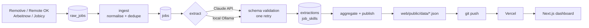

# Remote Radar

**What do remote employers actually ask for? A nightly pipeline reads remote job postings from four public job boards, extracts skills, seniority and salary with an LLM, and publishes the results as a public dashboard.**

[](https://github.com/intenza2k-netizen/remote-radar/actions/workflows/ci.yml)


[](LICENSE)

**Live demo:** https://remote-radar-nine.vercel.app


## Why I built this

I am moving into data analyst and data engineering roles without a traditional computer science background. When I read job ads I could not tell which requirements were common and which were one company's wish list, and I did not want to guess. So I built something that counts.

It also gave me a reason to build the whole chain once, end to end: collecting data from public APIs, cleaning it, using an LLM for the part that is genuinely unstructured, checking how accurate that LLM is, and publishing the result somewhere a person can look at it. It is a learning project, and the Methodology page on the site says plainly what the numbers can and cannot tell you.

## What it does

- **Collects** remote job postings every night from four public job-board APIs and keeps the raw responses so later steps can be re-run.
- **Cleans and deduplicates** them: normalises titles and companies, turns HTML into text, parses free-text salaries and collapses cross-posted duplicates.
- **Extracts structure with an LLM**: role, seniority, skills, employment type and salary, validated against a schema. The same prompt runs on the Claude API or on a local model through Ollama.
- **Measures the models**: both backends are scored against a hand-labelled set of postings, so the choice of model rests on accuracy, latency and cost rather than a hunch.
- **Publishes a static snapshot** (JSON files) that a Next.js dashboard renders:
  - **Overview**: most requested skills, weekly trends, role mix, advertised salary by seniority, sources.
  - **Skills**: searchable table with share of postings, four-week change and median salary.
  - **Skill detail**: weekly trend, skills it is requested with, recent matching jobs.
  - **Jobs**: filter postings by skill, seniority, role, region and salary; every result links to the original listing.
  - **Methodology**: how it works, extraction accuracy and known limitations.

## Architecture



The full diagram, the SQLite schema, design decisions and known limitations are in [docs/architecture.md](docs/architecture.md).

## Tech stack

| Layer | Tools |
|---|---|
| Pipeline | Python 3.12, [uv](https://docs.astral.sh/uv/), httpx, pydantic, SQLAlchemy, SQLite, Typer, Rich, selectolax, tenacity |
| LLM backends | Anthropic Python SDK (Claude), Ollama (local model on an RTX 5090) |
| Dashboard | Next.js 16 (App Router), React 19, TypeScript, Tailwind CSS 4, hand-written SVG charts |
| Quality | pytest, Ruff, ESLint, GitHub Actions |
| Operations | PowerShell and Windows Task Scheduler for the nightly run, Vercel for hosting |

## Model comparison

<!-- EVAL:START -->
The same prompt and schema were run on 40 labelled postings with four models: one hosted, three local on an RTX 5090.

| Model | Skills F1 [95% CI] | Seniority | Role | Salary | Median latency | Cost / 1k jobs |
|---|---|---|---|---|---|---|
| Claude Sonnet 5.5 (API) | 0.770 [0.70–0.82] | 0.850 | 0.900 | 0.900 | 2.3 s | $5.46 |
| gemma4 31B (local) | **0.832** [0.76–0.89] | 0.800 | 0.925 | 0.875 | 1.3 s | $0 |
| Qwen 3.8 27B (local) | 0.730 [0.64–0.79] | 0.825 | **0.950** | 0.850 | 1.5 s | $0 |
| gemma4 12B (local) | 0.670 [0.58–0.74] | 0.775 | 0.900 | 0.875 | 0.8 s | $0 |

- **What the data supports:** gemma4 12B is measurably worse at skills than the larger models. Claude and gemma4 31B are statistically indistinguishable on every field at this sample size (paired bootstrap).
- **Decision:** the nightly run uses gemma4 31B. It matches the hosted model within the noise, at zero marginal cost.
- **Caveat:** the 40 gold labels are drafts written by a Claude model before any extractor ran, and are awaiting human review, so they may favour Claude slightly. With 40 jobs, differences of a few points are noise. Claude has the highest skills recall (0.97) and gemma4 31B the highest precision (0.78), so the F1 ranking depends partly on how exhaustively the gold lists were written.

Full report with confidence intervals, paired comparisons, a seniority confusion matrix and error analysis: [`pipeline/eval/report.md`](pipeline/eval/report.md). Method and limitations: [`pipeline/eval/README.md`](pipeline/eval/README.md).
<!-- EVAL:END -->

## Data sources

Job data comes from public APIs. Every posting on the dashboard links back to the board that published it, and the published snapshot contains no job descriptions, only derived fields and the link.

| Source | Notes |
|---|---|
| [Remotive](https://remotive.com) | Remote jobs API. |
| [Remote OK](https://remoteok.com) | Remote OK's terms require crediting them and keeping links to them followed; both are done here. |
| [Arbeitnow](https://www.arbeitnow.com) | Free job board API. |
| [Jobicy](https://jobicy.com) | Remote jobs API. |

## Run it yourself

### Prerequisites

- [uv](https://docs.astral.sh/uv/) (installs Python 3.12 for you)
- Node.js 24 and npm
- [Ollama](https://ollama.com) with a model pulled, for example `ollama pull gemma4:12b`
- Optional: an `ANTHROPIC_API_KEY` to use the Claude backend

### Run the pipeline

```bash
cd pipeline
uv sync
uv run radar --help
```

Try a small run first (fetches everything, extracts only 20 jobs with a local model):

```bash
uv run radar run-all --backend ollama --model gemma4:12b --limit 20
```

`run-all` is `fetch -> ingest -> extract -> publish`, and it writes the snapshot to `web/public/data/`. The same stages are available one at a time:

```bash
uv run radar fetch                     # pull postings into raw_jobs
uv run radar ingest                    # normalise and mark duplicates
uv run radar extract --backend ollama  # LLM extraction (use --limit N to cap it)
uv run radar aggregate                 # print the summary, write nothing
uv run radar publish                   # write the snapshot JSON files
uv run radar stats                     # row counts per stage
```

To use Claude instead, set the key and pick the backend:

```bash
export ANTHROPIC_API_KEY=...           # PowerShell: $env:ANTHROPIC_API_KEY = "..."
uv run radar run-all --backend claude
```

The SQLite database is created at `data/jobs.sqlite` (git-ignored). Defaults can be changed with environment variables:

| Variable | Default | Meaning |
|---|---|---|
| `RADAR_BACKEND` | `ollama` | Extraction backend: `claude` or `ollama` |
| `RADAR_OLLAMA_MODEL` | `gemma4:12b` | Local model tag |
| `RADAR_CLAUDE_MODEL` | `claude-sonnet-5-5` | Claude model id |
| `RADAR_DATA_DIR` | `data/` in the repo root | Where the SQLite file lives |
| `ANTHROPIC_API_KEY` | none | Required for the Claude backend |

### Run the dashboard

```bash
cd web
npm ci
npm run dev        # http://localhost:3000
```

The dashboard reads only `web/public/data/*.json`. The repository ships sample data so it renders before you have run anything; the site shows a "Sample data" badge while those files are in place. To regenerate the sample data:

```bash
cd web
node scripts/make-sample-data.mjs
```

Running `radar publish` (or `run-all`) replaces the sample files with real ones.

### Tests and checks

```bash
cd pipeline
uv run pytest -q
uv run ruff check src tests eval
uv run ruff format --check src tests

cd ../web
npm run lint
npm run build
```

The tests are offline: sources and LLM clients are mocked from fixtures. The same checks run in CI on every push and pull request.

### Nightly run on Windows

`scripts/nightly.ps1` runs the pipeline, then commits `web/public/data` and pushes if a remote is configured. It logs to `data/logs/` and exits non-zero on failure.

```powershell
.\scripts\nightly.ps1 -DryRun -NoPush     # print the plan, change nothing
.\scripts\nightly.ps1 -NoPush             # real run, commit but do not push
.\scripts\register-nightly-task.ps1       # schedule it daily at 03:30 (asks for confirmation)
.\scripts\register-nightly-task.ps1 -Unregister
```

## Project structure

```
remote-radar/
├── .github/workflows/   CI: ruff and pytest for the pipeline, eslint and build for the web app
├── docs/                architecture notes
├── pipeline/
│   ├── src/radar/       sources, normalise, dedupe, skills, extract, aggregate, publish, CLI
│   ├── tests/           offline unit and pipeline tests with fixtures
│   ├── eval/            gold set and tooling for comparing extraction models
│   ├── pyproject.toml
│   └── uv.lock
├── scripts/             nightly.ps1 and register-nightly-task.ps1
├── web/
│   ├── src/             Next.js app, components, data helpers
│   ├── public/data/     the published JSON snapshot (committed)
│   └── scripts/         sample data generator
├── data/                SQLite database and logs (git-ignored)
├── LICENSE
└── README.md
```

## Roadmap

- **CV matcher**: paste a CV and see which in-demand skills it covers and which it is missing.
- **More sources**: further remote job boards and company career pages.
- **Postgres**: move the store off SQLite if the data outgrows one machine.
- **Alerts**: notify when a skill's share moves sharply or a matching job appears.

## Licence

[MIT](LICENSE) © 2026 navi
