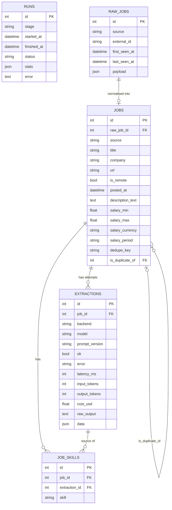

# Architecture

Remote Radar is a small batch pipeline plus a static website. Once a night a Python CLI
(`radar`) pulls remote job postings from four public APIs, turns the free text into
structured fields with an LLM, aggregates the result and writes a handful of JSON files.
Those files are committed to the repository, which triggers a Vercel build of a Next.js
dashboard that does nothing but read them.

There is no server, no API and no database in production. The only stateful thing is a
SQLite file on the machine that runs the pipeline.

## Data flow

```mermaid
flowchart LR
    subgraph SRC["Public job APIs"]
        S1["Remotive"]
        S2["Remote OK"]
        S3["Arbeitnow"]
        S4["Jobicy"]
    end

    S1 & S2 & S3 & S4 --> FETCH["radar fetch<br/>one request per page"]
    FETCH --> RAW[("raw_jobs<br/>payload as returned")]
    RAW --> INGEST["radar ingest<br/>normalise + dedupe"]
    INGEST --> JOBS[("jobs<br/>one row per posting")]

    JOBS --> EXTRACT{"radar extract<br/>canonical remote jobs"}
    EXTRACT -- "backend = claude" --> CLAUDE["Claude API"]
    EXTRACT -- "backend = ollama" --> OLLAMA["Local Ollama<br/>(RTX 5090)"]
    CLAUDE --> VALID["Schema validation<br/>one retry on bad output"]
    OLLAMA --> VALID
    VALID --> EXT[("extractions<br/>every attempt kept")]
    EXT --> ALIAS["Skill alias map<br/>aliases.yaml"]
    ALIAS --> SKILLS[("job_skills<br/>canonical slugs")]

    SKILLS --> AGG["aggregate<br/>shares, trends, salary percentiles"]
    JOBS --> AGG
    AGG --> PUB["radar publish<br/>atomic write"]
    PUB --> JSON["web/public/data/*.json"]

    GOLD[("pipeline/eval<br/>hand-labelled gold set")] --> EVAL["Eval harness"]
    CLAUDE -.-> EVAL
    OLLAMA -.-> EVAL
    EVAL --> EVALJSON["eval.json"]
    EVALJSON --> JSON

    JSON --> GIT["git commit + push<br/>scripts/nightly.ps1"]
    GIT --> VERCEL["Vercel build"]
    VERCEL --> NEXT["Next.js static dashboard"]
```

Fetch, ingest, extract and publish run as one command, `radar run-all`. Committing and
pushing the snapshot to GitHub (which triggers Vercel) is the nightly script's job
(`scripts/nightly.ps1`).

| Stage | Command | What it does |
|---|---|---|
| Fetch | `radar fetch` | Calls each source once per page and upserts the untouched JSON into `raw_jobs`. A failing source is logged and skipped; the stage only fails if every source fails. |
| Ingest | `radar ingest` | Maps each raw payload to the common `jobs` shape: cleans title and company, converts HTML to text, parses free-text salaries, and marks cross-posted duplicates with a company + title hash. |
| Extract | `radar extract` | Sends each canonical remote job that has no successful extraction for the current backend, model and prompt version to the LLM and stores every attempt. |
| Aggregate | `radar aggregate` | Computes the snapshot in memory over an 8-week window and prints a summary (writes nothing). |
| Publish | `radar publish` | Writes `meta`, `skills`, `roles`, `salary` and `jobs` JSON files via temp files and renames, so a crash cannot leave a half-written snapshot. |

## SQLite schema

Defined in `pipeline/src/radar/models.py`. The file lives at `data/jobs.sqlite` (git-ignored).

| Table | Purpose | Key constraints |
|---|---|---|
| `runs` | One row per pipeline stage execution with status (`ok`, `partial`, `failed`) and counters. | |
| `raw_jobs` | The source response for one posting, exactly as returned. | Unique on (`source`, `external_id`). |
| `jobs` | Normalised, source-agnostic posting. Duplicates point at the canonical row. | `raw_job_id` unique; `dedupe_key` indexed; `is_duplicate_of` self-reference. |
| `extractions` | One LLM attempt per job, tagged with backend, model and prompt version, including cost, latency, raw output and parsed data. | Indexed on `job_id` and `backend`. |
| `job_skills` | Canonical skill slugs for a job, derived from its current extraction. | Unique on (`job_id`, `skill`). |

## Published snapshot

Everything the website reads lives in `web/public/data/`:

| File | Content |
|---|---|
| `meta.json` | Generation time, backend and model used, totals, per-source counts, weekly volume. |
| `skills.json` | Per skill: count, share of jobs, 4-week change, median salary, weekly trend, co-occurring skills. |
| `roles.json` | Role mix with median salary. |
| `salary.json` | Percentiles by seniority and by role (only where at least 5 postings state a salary). |
| `jobs.json` | Postings from the last 60 days without descriptions, each linking to the original board. |
| `eval.json` | Per-model accuracy, latency and cost from the eval harness. Written by the eval step, not by `publish`. |

All salaries are annualised and converted to USD.

## Design decisions

| Decision | Why |
|---|---|
| **Static JSON snapshot instead of an API** | The data changes once a day and is the same for every visitor, so files on a CDN are cheaper, faster and have nothing to keep running or secure than an API plus database. |
| **SQLite as the local source of truth** | One file, no service to run, full SQL for the aggregation, and trivial to back up or delete; the pipeline runs on one machine so there is no concurrency to manage. |
| **Raw payloads kept in `raw_jobs`** | Parsing rules, the prompt and the skill map will all change; storing what the API returned lets me re-run later stages on old data instead of losing it. |
| **LLM output validated against a schema, one retry** | A model can return malformed or out-of-range JSON, so every reply is checked against a pydantic schema and the model gets one chance to correct itself; after that the attempt is recorded as failed rather than guessed at. |
| **Every extraction attempt is stored, keyed by backend, model and prompt version** | Re-running with a new model or prompt only touches jobs that lack a result for that combination, and the cost and failure counts per model come straight from the table. |
| **Two interchangeable backends (Claude API, local Ollama) behind one interface** | The same prompt and schema run on both, so a hand-labelled gold set can measure the accuracy, latency and cost difference instead of me guessing, and the nightly run can use whichever the eval supports. |
| **Skill alias map (`aliases.yaml`)** | Models and boards write the same skill many ways (`React.js`, `reactjs`, `React JS`); mapping them to one slug, with a category, makes counts meaningful and unknown skills still survive as a slugified `other`. |
| **Dedupe on a normalised company + title hash** | Boards cross-post the same role; a cheap, deterministic key catches most of it without fuzzy matching, and the earliest posting stays canonical so ids are stable across runs. |
| **Static FX table for salary conversion** | Salaries only need to be comparable across postings, not priced to the cent, so a dated table of rounded rates avoids an extra API dependency and keeps runs reproducible. |
| **Whole-ISO-week window with minimum sample sizes** | Eight Monday-aligned weeks make weekly buckets comparable, and skills, salary percentiles and 4-week changes are only published when enough postings back them. |
| **Atomic publish and a refusal to publish an empty window** | The previous good snapshot stays live if a run dies halfway or a source returns nothing. |

## Known limitations

- **Four boards are not the market.** The sources skew towards tech roles and towards
  employers that pay to advertise on job boards. Percentages describe these postings only.
- **Remotive limits the free API to a small number of jobs per request,** so it contributes
  fewer postings per run than the other sources.
- **History starts at the first run.** Postings are only seen when they are published
  while the pipeline runs (or are still listed), so early trend lines are short and the
  latest week is always partial.
- **Most postings state no salary.** Salary statistics rest on the subset that does, and are
  suppressed below five postings. Advertised pay is not paid pay.
- **FX rates are approximations** from a static table with a stated date, not market data.
  Hourly and monthly figures are annualised with fixed multipliers (2,080 hours, 12 months).
- **LLM extraction is probabilistic.** A model can miss a skill, infer one that was only
  implied or misjudge seniority. Descriptions are truncated before they reach the model,
  and the local model is less accurate than Claude (the eval quantifies by how much).
- **The eval gold set is small and labelled by one person,** so its numbers carry real
  uncertainty and should be read as a guide, not a benchmark.
- **Deduplication is exact-ish.** The same job posted by a recruiter under another company
  name, or with a reworded title, is counted twice.
- **"Remote" is defined by each source.** Some boards list jobs as remote that restrict
  applicants to certain countries; the snapshot keeps the stated regions but does not
  filter on where you live.
- **The automation is Windows-specific.** `scripts/nightly.ps1` and the Task Scheduler
  registration assume the Windows machine with the GPU that runs the local model. The
  pipeline itself is plain Python and runs anywhere.
