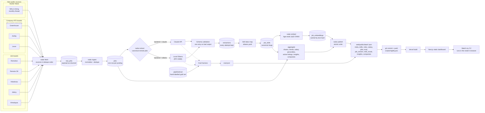
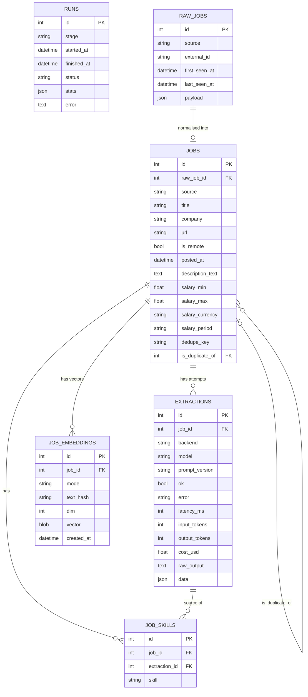

# Architecture

Remote Radar is a small batch pipeline plus a static website. Once a night a Python CLI
(`radar`) pulls remote job postings from nine public sources, turns the free text into
structured fields with an LLM, computes a vector for each listed job, aggregates the
result and writes a handful of JSON files. Those files are committed to the repository,
which triggers a Vercel build of a Next.js dashboard that does nothing but read them.

The nine sources are five job-board APIs, the public job-board APIs of 44 curated
companies (Greenhouse, Ashby and Lever) and the monthly Hacker News "Who is hiring"
thread. One page on the site, Match my CV, also does real work in the visitor's browser
(see [The in-browser matcher](#the-in-browser-matcher)). Everything else is read-only.

There is no server, no API and no database in production. The only stateful thing is a
SQLite file on the machine that runs the pipeline.

## Data flow

Fetch, ingest, extract, embed and publish run as one command, `radar run-all`. Committing
and pushing the snapshot to GitHub (which triggers Vercel) is the nightly script's job
(`scripts/nightly.ps1`).

| Stage | Command | What it does |
|---|---|---|
| Fetch | `radar fetch` | Calls each source in turn (one request per page where the API is paged) and upserts the untouched JSON into `raw_jobs`. A failing source is logged and skipped; the stage only fails if every source fails. The run records which sources succeeded, which the active-listing rule needs. |
| Ingest | `radar ingest` | Maps each raw payload to the common `jobs` shape: cleans title and company, converts HTML to text, parses free-text salaries, and marks cross-posted duplicates with a company + title hash. |
| Extract | `radar extract` | Sends each canonical remote job that has no successful extraction for the current backend, model and prompt version to the LLM and stores every attempt. |
| Embed | `radar embed` | Turns each listed job into a 384-number vector with the same embedding model the browser uses, and caches it by a hash of the embedded text. Only new or changed jobs are embedded. |
| Aggregate | `radar aggregate` | Computes the snapshot in memory over an 8-week window and prints a summary (writes nothing). |
| Publish | `radar publish` | Writes `meta`, `skills`, `roles`, `salary`, `jobs`, `job_vectors`, `skill_vocab`, `insights` and `companies` JSON files via temp files and renames, so a crash cannot leave a half-written snapshot. |

## Dedupe order and source scope

The sources are fetched in a fixed order (`ALL_SOURCES` in
`pipeline/src/radar/sources/__init__.py`):

1. Remotive
2. Remote OK
3. Arbeitnow
4. Jobicy
5. Himalayas
6. Greenhouse boards
7. Ashby boards
8. Lever boards
9. Hacker News "Who is hiring"

Public job boards come first, then company ATS boards, then Hacker News. The order only
matters for the dedupe step. A job already in the database keeps its canonical copy, and a
new posting with the same company + title key becomes a duplicate of it. Within one ingest
batch the posting with the earliest `posted_at` wins, and ties go to the lower raw id,
which follows this fetch order.

Each source also has a `scope`:

| Scope | Meaning | Sources |
|---|---|---|
| `targeted` | Searched or filtered toward data roles. | Himalayas (keyword searches), Jobicy (also reads the data-science industry feed), Remote OK (also reads the data, data-science and analyst tag feeds) |
| `broad` | Read without a data-role filter. | Remotive, Arbeitnow, Greenhouse, Ashby, Lever, Hacker News |

"Broad" means the source is not filtered by role. It does not mean the source covers the
market. The Greenhouse, Ashby and Lever sources read the public job-board APIs of the 44
companies listed in `pipeline/src/radar/sources/ats_companies.yaml` and keep remote
postings only. The Hacker News source reads the latest "Who is hiring" thread (and the
previous month's while the latest is under 10 days old) through the Algolia API and keeps top-level
comments whose first line says remote. The published `meta.json` carries each source's
scope, and the Methodology page uses it to state how much of the data comes from targeted
sources.

## Active listings

A job counts as active if its source still listed it recently. The rule is in
`pipeline/src/radar/aggregate.py` (`active_listings`), with the constant in
`pipeline/src/radar/config.py`:

- For each source, the reference time is the finish time of its latest successful fetch.
  Wall-clock time is not used, so a pipeline that has not run for a week keeps what it has.
- A posting is listed if it was last seen within `ACTIVE_DAYS` (3 days) of that reference.
- A canonical job is active if its own posting or any of its duplicates is listed. The
  published link comes from the most recently seen listed copy, so it is not a dead link.
- Postings from a source that is no longer fetched are never active.

The lists on the site (jobs, matcher, companies) show only active jobs posted in the last
60 days. The statistics (skill shares, trends, salary percentiles) still use every posting
in the 8-week window (56 days), active or not. In the snapshot of 6 November 2026 that was
3,129 postings in the window and 3,268 active listings. The two numbers are not
comparable as a share: the window counts postings by posting date whether or not they are
still open, while the jobs list keeps only active jobs and reaches back 60 days.

## The in-browser matcher

The `/match` page ("Match my CV") ranks jobs for a pasted or uploaded CV without sending the
CV anywhere. The code is in `web/src/lib/match/`.

1. The pipeline embeds each listed job with `Xenova/bge-small-en-v1.5` (fp32 ONNX, through
   `radar embed`, `pipeline/src/radar/embed.py`). The text is the title, role, seniority,
   top skills and the first 1,500 characters of the description. Descriptions are never
   published, only the vectors.
2. Vectors go into `job_vectors.json` as int8 with one scale per vector. The notes in
   `embed.py` say this round trip keeps cosine similarity above 0.999.
3. In the browser, a Web Worker loads the same model with transformers.js (q8, WebAssembly)
   and embeds the CV in chunks. The model files (about 30 MB) are downloaded once from
   Hugging Face and cached by the browser. This is the only third-party request. The CV text
   stays in the page and the worker.
4. CV skills are found by matching the CV text against `skill_vocab.json`, built from the
   same alias map the pipeline uses. The user can edit the detected skills.
5. Each job gets a hybrid score. The weights are in `web/src/lib/match/constants.ts`:

| Component | Weight | What it measures |
|---|---|---|
| Semantic similarity | 0.40 | Cosine similarity between the CV and the posting, stretched between 0.55 and 0.80 |
| Skill overlap | 0.35 | Share of the job's listed skills that the CV has, pulled toward a prior |
| Seniority fit | 0.15 | Distance between the CV's level and the posting's level |
| Role fit | 0.10 | 1 if the job's role is one the user picked, otherwise 0 |

The skill overlap uses a coverage prior, so a posting that lists one skill does not outrank
a posting that lists ten and matches eight. A component that cannot be computed (no role
chosen, no skills listed) is dropped and the other weights are rescaled, so the score
stays on one 0 to 100% scale.

The browser uses the q8 model and the pipeline uses fp32. The notes in `embed.py` measured
a cosine of 0.9935 or higher between the two on five test sentences, so the vectors are in
the same space but not identical. Cosines between a CV and a posting also sit in a narrow
band with this small model, which is why the score stretches the range between 0.55 and
0.80. The page shows the raw cosine in the score breakdown.

Four analyses sit on top of the ranking, all computed in the browser from the published files
and trimmed on the server first (`lib/match/extras.ts`, so no centroids or plot coordinates are
sent): (1) the "I can work from" location filters the postings with `isOpenTo` from `lib/geo.ts`
(the rule the Python pipeline pins with fixtures) before they are scored, and picks the region
group for the pay estimate; (2) the job type of each of the 30 best data matches comes from the
`archetypes.json` assignment of that posting, which is steadier than comparing a CV vector with
cluster centroids; (3) `predictPay` from `lib/salary-model.ts` turns role, seniority, region group
and CV skills into an 80% range shown next to the model's held-out error; (4) the next skill is
ranked by re-scoring only the skills part of every posting with the skill added (the other terms do
not change), counting postings that enter the top 30 or become well covered (two thirds of their
listed skills, at least three listed), with the skill's pay coefficient and interval beside it.

## SQLite schema

Defined in `pipeline/src/radar/models.py`. The file lives at `data/jobs.sqlite` (git-ignored).

| Table | Purpose | Key constraints |
|---|---|---|
| `runs` | One row per pipeline stage execution with status (`ok`, `partial`, `failed`) and counters. | |
| `raw_jobs` | The source response for one posting, exactly as returned. | Unique on (`source`, `external_id`). |
| `jobs` | Normalised, source-agnostic posting. Duplicates point at the canonical row. | `raw_job_id` unique; `dedupe_key` indexed; `is_duplicate_of` self-reference. |
| `extractions` | One LLM attempt per job, tagged with backend, model and prompt version, including cost, latency, raw output and parsed data. | Indexed on `job_id` and `backend`. |
| `job_skills` | Canonical skill slugs for a job, derived from its current extraction. | Unique on (`job_id`, `skill`). |
| `job_embeddings` | Cached embedding of a job's passage text for the CV matcher, as a normalised float32 vector. | Unique on (`job_id`, `model`, `text_hash`); a changed text gets a new hash and is embedded again. |

## Published snapshot

Everything the website reads lives in `web/public/data/`:

| File | Content |
|---|---|
| `meta.json` | Generation time, backend and model used, totals (window postings, active listings, companies, skills), per-source counts and scope, weekly volume. |
| `skills.json` | Per skill: count, share of jobs, 4-week change, median salary, weekly trend, co-occurring skills. |
| `roles.json` | Role mix with median salary. |
| `salary.json` | Percentiles by seniority and by role (only where at least 5 postings state a salary). |
| `jobs.json` | Active postings from the last 60 days without descriptions, each linking to the original page (the most recently seen copy). |
| `eval.json` | Per-model accuracy, latency and cost from the eval harness. Written by the eval step, not by `publish`. |
| `job_vectors.json` | One int8 vector per listed job with a per-vector scale, plus the model name and the query prefix the browser must use. Read by the CV matcher. |
| `skill_vocab.json` | Skill names, aliases and match patterns the browser uses to read skills out of a CV. |
| `insights.json` | Skill pay premium, raw (difference of medians) and adjusted for role, seniority and region group (regression of log salary, Frisch-Waugh-Lovell per resample), both with company-cluster bootstrap intervals from the same resamples (at least 5 companies per skill), seniority lift, skill co-occurrence graph (PMI) with a force layout computed at build time, role-skill profiles. |
| `companies.json` | One row per hiring company with its postings, for `/companies` and `/companies/[slug]`. |
| `geo.json` | Per country and macro region: how many listed postings are open to applicants there, how many are data roles, median advertised pay, top skills of the open data jobs; plus the region membership lists the browser needs and the mix of the window by region group. For `/locations` and the "Open to applicants in" filter on `/jobs`. |
| `archetypes.json` | Job types: clusters of the listed `role == "data"` postings by embedding, with per-cluster size, seniority mix, signature skills (share and lift), common titles, median advertised pay (only with 5 or more salaries), three example postings, the embedding centroid (for the matcher) and PCA coordinates per posting for the scatter plot. For `/job-types`. |

All salaries are annualised and converted to USD.

**Where you can work from (`geo.json`).** "Remote" often means remote within one country, so `radar.geo` scores every listed posting against every country and macro region (EU, EEA, Europe, EMEA, Americas ...), using the `memberships:` block of `regions.yaml`. A posting is open to a location when its regions contain `worldwide`, the location itself, or a macro region that contains it (for a macro location the posting must cover the whole region); postings with no region are counted as unknown and never as open. The same rule is implemented in TypeScript (`web/src/lib/geo.ts`) so the jobs filter can apply it in the browser, and a fixture computed in Python (`geo.fixtures.json`) keeps the two in step.

**Job types (`archetypes.json`).** `radar.archetypes` clusters the listed postings whose extracted role is `data` and that have a vector (the decoded `job_vectors.json`) with spherical k-means: unit vectors, cosine distance, k-means++ seeding, best of 10 seeded restarts per k, k from 6 to 12 (never more than one cluster per 5 postings). Each k is scored by the mean cosine silhouette, which is low and flat for text embeddings, so k follows a stated rule: among the k within 0.01 of the best silhouette, the one whose clusters are named after the most different title families, then the smaller k. Names are rule-based and deterministic: a curated keyword list maps titles to a family (data engineer, analytics engineer, BI analyst, ...), a cluster takes its dominant family, and clusters that share a family get the skill that best separates them from their siblings in brackets. Each archetype also publishes `family_share` (the share of its titles in that family) and its own mean silhouette, and the page flags fuzzy or mixed-title clusters instead of hiding them. Lift is the smoothed share in the cluster over the smoothed share in all data postings; signature skills are ranked by `share * ln(lift)`. The plot coordinates are the first two principal components, and `method.pca_variance` records how little of the variance they keep. With fewer than 30 data postings the file holds no archetypes and the page shows an empty state.

**Pay estimator (`salary_model.json`).** `radar.salary_model` fits a ridge regression of `log(annual_usd_mid)` on role, seniority, `region_group` dummies (most common level as reference) and 0/1 indicators for skills with at least 15 salaried postings from at least 5 companies, in closed form with numpy (intercept unpenalised). Because a few companies contribute dozens of postings each, every split is grouped by company: 5 balanced folds, no company in both train and test, and the penalty `alpha` is chosen again inside each training part (nested), so the published MAE, median absolute percentage error and log-scale R² are out-of-fold figures. The 80% range is the 10th/90th percentile of the out-of-fold log residuals, and its coverage is measured cross-fitted. The baseline (median pay of the same role and seniority, falling back to role, then overall) is scored on the same folds and compared by a company-cluster bootstrap; the document carries `eval.verdict` (`better`, `similar` or `worse`) and a sentence, so a model that does not beat the baseline says so. A CV (or the estimator form) is turned into a number by the profile rule: unknown skills are ignored, the rest are ordered by market frequency and capped at `profile_max_skills` (the median skills per salaried posting). The browser runs one implementation, `predictPay` in `web/src/lib/salary-model.ts`, and `salary-model.fixtures.json`, computed in Python, keeps it and `regionGroupOf` in step with `radar.salary_model.predict_pay` and `radar.regions.region_group`. With fewer than 100 salaried postings the file holds only `{version, reason}`.

## Design decisions

| Decision | Why |
|---|---|
| **Static JSON snapshot instead of an API** | The data changes once a day and is the same for every visitor, so files on a CDN are cheaper, faster and have nothing to keep running or secure than an API plus database. |
| **SQLite as the local source of truth** | One file, no service to run, full SQL for the aggregation, and trivial to back up or delete; the pipeline runs on one machine so there is no concurrency to manage. |
| **Raw payloads kept in `raw_jobs`** | Parsing rules, the prompt and the skill map will all change; storing what the API returned lets me re-run later stages on old data instead of losing it. |
| **LLM output validated against a schema, one retry** | A model can return malformed or out-of-range JSON, so every reply is checked against a pydantic schema and the model gets one chance to correct itself; after that the attempt is recorded as failed rather than guessed at. |
| **Every extraction attempt is stored, keyed by backend, model and prompt version** | Re-running with a new model or prompt only touches jobs that lack a result for that combination, and the cost and failure counts per model come straight from the table. |
| **Two interchangeable backends (Claude API, local Ollama) behind one interface** | The same prompt and schema run on both, so a hand-labelled gold set can measure the accuracy, latency and cost difference instead of me guessing, and the nightly run can use whichever the eval supports. |
| **Skill alias map (`aliases.yaml`)** | Models and boards write the same skill many ways (`React.js`, `reactjs`, `React JS`); mapping them to one slug, with a category, makes counts meaningful and unknown skills still survive as a slugified `other`. |
| **Dedupe on a normalised company + title hash** | Boards cross-post the same role; a cheap, deterministic key catches most of it without fuzzy matching, and the earliest posting stays canonical so ids are stable across runs. |
| **Static FX table for salary conversion** | Salaries only need to be comparable across postings, not priced to the cent, so a dated table of rounded rates avoids an extra API dependency and keeps runs reproducible. |
| **Whole-ISO-week window with minimum sample sizes** | Eight Monday-aligned weeks make weekly buckets comparable, and skills, salary percentiles and 4-week changes are only published when enough postings back them. |
| **Atomic publish and a refusal to publish an empty window** | The previous good snapshot stays live if a run dies halfway or a source returns nothing. |
| **Fixed source order for dedupe (job boards, then company ATS boards, then Hacker News)** | The same role is often on a board and on the company's own career page. Boards are fetched first, so the copy already in the database stays canonical on later runs and ids stay stable. Within one batch the earliest posting wins and the fetch order breaks ties. The order is a convention, not a ranking of quality. |
| **Active listings for the lists, the full 8-week window for statistics** | A visitor should not be sent to a job that is gone, so lists show only jobs a source still listed within 3 days of its latest successful fetch. Statistics need history, including jobs that have since closed, so they use the whole window. Measuring against each source's own last fetch, not the wall clock, means a pipeline that stops for a week does not empty the site. |
| **Match CVs in the browser, not on a server** | A CV is personal data. Matching in the browser means it is never uploaded, logged or stored, and there is no backend to build, secure or pay for, which suits free static hosting. The cost is a one-time download of about 30 MB of model files and slower first use on weak devices. |
| **Job vectors computed by the pipeline and published as int8** | Embedding thousands of jobs in each visitor's browser would be slow. The pipeline does it once per night, caches by text hash, and ships compact vectors with a scale per vector. The browser only embeds one CV. |
| **A hybrid match score with visible parts** | Semantic similarity alone is vague and skill overlap alone ignores seniority and role. The score is a fixed weighted mix, with every weight in one file and the breakdown shown for each job, so a result can be checked rather than trusted. |

## Known limitations

- **Nine sources are not the market, and part of the data is aimed at data roles.**
  Himalayas, Jobicy and Remote OK are searched or filtered toward data roles (marked
  `targeted` in `meta.json`), so data roles are deliberately over-represented. In the
  snapshot of 6 November 2026 those three sources supply about 47% of the postings in the
  window and data roles are 35% of all postings. The skill shares are therefore not the share
  of all remote jobs. Compare skills with each other, not with the wider market. The
  Methodology page states the targeted share for the current snapshot.
- **The company list is curated, not sampled.** Greenhouse, Ashby and Lever are read for 44
  companies picked by hand, remote postings only. Companies that use other systems, or that
  I did not list, are absent. Hacker News adds only employers who post there and write
  "remote" in the first line. All sources skew towards tech roles and towards employers
  that publish openly. Percentages describe these postings only.
- **Remotive limits the free API to a small number of jobs per request,** so it contributes
  fewer postings per run than the other sources.
- **"Active" is only as good as each source.** A job counts as active if a source still
  listed it within 3 days of that source's last successful fetch. A source can keep a filled
  job listed, and a source whose fetch failed keeps its older reference time.
- **The CV matcher is a ranking aid, not a judgement.** Skills are found by pattern
  matching against a vocabulary, so a skill written in an unusual way is missed (the user
  can add it). Seniority is guessed from title words and years of experience. Similarity
  comes from a small model, and its scores are compressed into a narrow band.
- **The skill pay premium controls for role, seniority and region group only.** The Insights page shows,
  by default, how much more postings that mention a skill advertise than postings of the same
  role, seniority and region group that do not (least squares on log salary, one skill at a
  time), and lets the reader switch to the raw difference of medians. Company, the other
  skills in a posting and the exact location are not controlled for, so the number is an association, not the pay a skill
  adds. The site says so.
- **History starts at the first run.** Postings are only seen when they are published
  while the pipeline runs (or are still listed), so early trend lines are short and the
  latest week is always partial.
- **Most postings state no salary.** Salary statistics rest on the subset that does, and are
  suppressed below five postings. Advertised pay is not paid pay.
- **FX rates are approximations** from a static table with a stated date, not market data.
  Hourly and monthly figures are annualised with fixed multipliers (2,080 hours, 12 months).
- **LLM extraction is probabilistic.** A model can miss a skill, infer one that was only
  implied or misjudge seniority. Descriptions are truncated before they reach the model,
  and the local model is less accurate than Claude (the eval quantifies by how much).
- **The eval gold set is small and labelled by one person,** so its numbers carry real
  uncertainty and should be read as a guide, not a benchmark.
- **Deduplication is exact-ish.** The same job posted by a recruiter under another company
  name, or with a reworded title, is counted twice.
- **"Remote" is defined by each source.** Some boards list jobs as remote that restrict
  applicants to certain countries; the snapshot keeps the stated regions but does not
  filter on where you live.
- **The automation is Windows-specific.** `scripts/nightly.ps1` and the Task Scheduler
  registration assume the Windows machine with the GPU that runs the local model. The
  pipeline itself is plain Python and runs anywhere.
